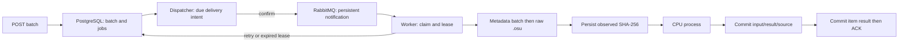

# Реализованная обработка пакетов

M2: PostgreSQL acceptance/outbox/leases, RabbitMQ notifications, отдельные dispatcher
и worker. Исходное направление: [batch-import](batch-import.md), решение:
[ADR-0007](../adr/0007-durable-batch-delivery.md).

## API

```powershell
$key = [guid]::NewGuid().ToString()
$body = @{provider='hinamizawa'; items=@(@{beatmap_id=1960574}, @{beatmap_id=658127})} | ConvertTo-Json -Depth 4
$batch = Invoke-RestMethod -Method Post http://localhost:8000/analysis-batches -ContentType application/json -Headers @{'Idempotency-Key'=$key} -Body $body
Invoke-RestMethod "http://localhost:8000/analysis-batches/$($batch.id)"
Invoke-RestMethod -Method Post "http://localhost:8000/analysis-batches/$($batch.id)/cancel"
```

POST возвращает 202 после commit в БД, `Location` и полный snapshot batch/items.
Ключ обязателен, формат UUID. Тот же key/request возвращает прежний batch с текущим
прогрессом; другой request под тем же key — 409. Повторы одинакового ID/pin удаляются
с сохранением порядка; конфликтующие pins — 422. На item опционален `expected_sha256`
(64 lowercase hex). Provider сейчас только hinamizawa, URL/set IDs не принимаются.
До 100 входных entries, после dedup отдельная job на ID. Глобальная admission квота
1000 unfinished jobs защищена advisory transaction lock; переполнение — 429 с
Retry-After 5. Ошибка БД — безопасный 503. Неизвестный batch UUID — 404.

Items: queued → running → succeeded/failed/retry_wait; retry_wait → running.
Cancel переводит unfinished в cancelled. Snapshot содержит attempts, analysis_id,
expected/observed SHA-256, следующий retry, последний code/message и counts по статусам.
Итог batch: completed, completed_with_errors, failed или cancelled; до завершения —
pending/running. GET читает состояние, внешнюю сеть не вызывает. История каждой
попытки не хранится: job содержит последнее состояние, analysis/source — свои snapshots.

## Выполнение и восстановление



Dispatcher публикует due items, периодически восстанавливает expired running jobs.
Notification — только `version=1,item_id`; без bytes, metadata, credentials и результатов.
Повторная доставка проверяет состояние/lease. После confirm+DB failure повтор
допустим. После result commit+worker failure повтор переиспользует analysis identity.
Старый lease не может записать success/error/pin или продлиться после отмены/истечения.

Пять попыток, lease 90 s, heartbeat 15 s, повтор уведомления через 30 s, polling
dispatcher 1 s. Worker capacity 1..32, default 1; prefetch/import/CPU slots согласованы.
Контракт: [runtime-workers](runtime-workers.md). AMQP connection/publish
ограничены 5 s; недоступность транспорта даёт reconnect с паузой 5 s. Queue durable,
2000 ready messages, overflow reject-publish; single-node, volume сохраняет broker state.

Retry учитывает provider Retry-After и exponential minimum до 300 s. При исчерпании
job failed; продолжить можно новым batch/key только для нужных IDs. 404/missing,
неподдержанные mode/encoding/format, hash/ID conflict постоянны. Unresolved retryable.
Смена pipeline identity между acceptance и execution даёт явную ошибку элемента.
Сломанный CPU pool сохраняет retry, затем worker выходит с exit 1; Compose restart
policy создаёт новый worker/pool. При локальном запуске CLI его нужно перезапустить.

Общий Hinamizawa budget хранится в PostgreSQL: разрешение перед каждым реальным
metadata/file HTTP, pacing 1.05 s, cooldown продлевается монотонно. Cache hits не
расходуют сетевой budget. Официальный OAuth/verify не перенаправляется на зеркало;
автоматического official→mirror fallback по-прежнему нет.

## Input lifetime

4 MiB/input, raw bytes только RAM во время попытки; objects только внутри CPU.
До расчёта SHA-256 сохраняется в job и становится pin дальнейших retry. После crash
идёт полный GET, 304 без bytes не используется. Если зеркало больше не отдаёт ту же
редакцию, retry завершится ошибкой. После попытки байты освобождаются; source staging
на диске не создаётся, orphan cleanup отсутствует по этой причине. Постоянные данные
табличные; payloads/медиа/objects не входят в job rows.

Отмена кооперативная: запрос/heartbeat может остановить ожидание и download; уже
работающий CPU не прерывается мгновенно. Его валидный result может сохраниться,
но cancelled item не станет succeeded задним числом. Подробности атомарности и
границ: [ADR-0007](../adr/0007-durable-batch-delivery.md).

## Запуск

```text
docker compose up --build --wait api dispatcher worker
uv run --locked python -m osu_skill_lab.workers dispatcher
uv run --locked python -m osu_skill_lab.workers worker
```

Отдельные entrypoints используют `OSU_LAB_DATABASE_URL`, `OSU_LAB_RABBITMQ_URL` и
mirror settings. API при старте не подключается к broker. Health/ready по-прежнему
проверяет БД: доступность приёма задания отличается от доступности его исполнения.
Для интеграционных проверок нужен `OSU_LAB_TEST_RABBITMQ_URL` дополнительно к test DB.
CI настроен на PostgreSQL+RabbitMQ; удалённый запуск не заявляется выполненным.
