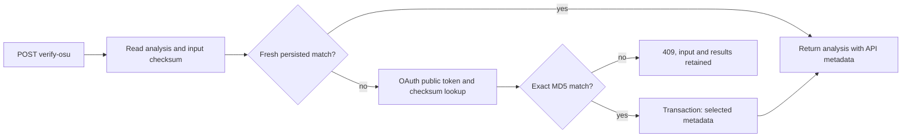

# osu! API: metadata и сверка checksum

Реализован первый сценарий M1a: локальная `.osu` уже загружена и проанализирована;
`POST /analyses/{analysis_id}/verify-osu` получает metadata из osu! API v2 и
сопоставляет её с точными байтами ранее обработанного входа через MD5 checksum.
Исходник повторно не требуется: его digest сохранён в `beatmap_inputs`.
Это проверка identity/metadata, не новый difficulty/pp calculation.

## Конфигурация и использование

Зарегистрируйте OAuth application в
[настройках osu!](https://osu.ppy.sh/home/account/edit#oauth).
Для client credentials callback URL не нужен. Настройте локально оба значения:

```dotenv
OSU_LAB_OSU_CLIENT_ID=<your-client-id>
OSU_LAB_OSU_CLIENT_SECRET=<your-client-secret>
OSU_LAB_OSU_TIMEOUT_SECONDS=10
OSU_LAB_OSU_CACHE_TTL_SECONDS=3600
```

ID и secret опциональны вместе; пустые значения из Compose отключают интеграцию.
Одно заполненное значение без второго отклоняется при старте. Secret не нужно
передавать в chat, URL или HTTP body нашего endpoint. Он читается сервером из
окружения/`.env`; Compose передаёт его контейнеру. После изменения `.env`
пересоздайте API через `docker compose up -d --wait api`.
Не публикуйте вывод `docker compose config`/inspect с реальными credentials.

```powershell
Invoke-RestMethod -Method Post http://localhost:8000/analyses/1/verify-osu
Invoke-RestMethod http://localhost:8000/analyses/1
```

Используйте ID существующего анализа. Endpoint принимает только ID, без файла
и пользовательских OAuth credentials. Raw upload продолжает работать независимо
от внешней API-конфигурации. Health не проверяет osu! и не получает OAuth token.

## Поток и контракт



OAuth использует `client_credentials`, scope `public`; token и срок действия
живут только в памяти. При 401 token обновляется и GET повторяется один раз.
После повторного 401/403 включается cooldown без циклических попыток.

Lookup передаёт только `checksum`. Filename и заявленные IDs не передаются:
они не должны приводить к fallback-поиску иной редакции. Ответ валидируется:
положительные IDs, совпадение nested set ID, osu!standard, строки ограниченной
длины без NUL, timezone-aware timestamp и валидный MD5, если он присутствует.
Отсутствующий checksum разрешён upstream контрактом, но не подтверждает связь.

Успех — HTTP 200 с тем же анализом и дополнительными полями `beatmap`:

- `identity_status="checksum_match"` и `osu` с API IDs, checksum, title/artist,
  `set_creator`, creator ID, difficulty name, status и временными полями;
- `claimed_ids_match`: `true`, если все присутствующие file claims совпали,
  `false` при конфликте, `null` при отсутствии claimed IDs;
- `osu.fetched_at` — когда получен ответ; `last_updated` — время карты из API;
  `api_response_version` и `metadata_schema_version` описывают HTTP/DTO контракт.

Исходные title/creator и claimed IDs не перезаписываются. `set_creator` относится
к набору, а `creator_id` взят из `user_id` карты; они не объявляются одним автором.
Features, algorithm/parser versions, created_at и идентичность результата сохраняются.
GET и список анализов возвращают сохранённую metadata без сетевых обращений.

`checksum_match` означает наблюдавшееся совпадение MD5 с API на `fetched_at`.
Это не криптографическое доказательство и не обещание текущей редакции сайта:
SHA-256 остаётся локальной идентичностью точных байтов. После TTL старое наблюдение
видно в GET, но явная повторная verify обращается к API. При ошибке refresh
сохранённая metadata не удаляется и не выдаётся за свежую проверку.

## Хранение и ограничения запросов

`osu_beatmap_matches` — одна строка на `input_id` с FK к `beatmap_inputs`.
Сохраняется только выбранная scalar metadata и 16-байтовый checksum, без полного
API JSON, media, failtimes, difficulty rating или pp. Это обновляемый metadata cache,
не история количественных расчётов из ADR-0004. Более старое `fetched_at` не может
перезаписать новую запись при конкурентном сохранении.

Успешная проверка кешируется в PostgreSQL на заданный TTL, от 60 s до суток;
по умолчанию 1 h. Она переиспользуется после перезапуска API. Адаптер также имеет
LRU-cache максимум на 256 checksum: успех на TTL, ошибки/прерванные запросы на 60 s.
Негативный cache не переживает перезапуск. Cache не содержит исключений с traceback,
сырых ответов или access tokens. Новое наблюдение требует доступного внешнего API.

На экземпляр API разрешены два незавершённых verify; прочие получают 429.
HTTP-запросы адаптера сериализованы с интервалом 1.05 s, включая OAuth, без burst.
429 upstream блокирует новые обращения; `Retry-After` поддерживает seconds/HTTP date,
минимум 60 s, верхний защитный предел 7 суток. Default при неверном header — 60 s.
Немедленного retry 5xx/timeout нет; повтор того же checksum ограничен cache.

Это лимиты одного процесса API, а не распределённый limiter на общий client ID.
Перед запуском нескольких экземпляров нужен общий координатор/бюджет запросов;
M2 пока не реализован. Redirects не выполняются; host фиксирован, произвольный
URL пользователя не принимается. HTTPX не использует proxy-переменные окружения.
Есть общий timeout одного HTTP exchange и лимиты decoded response: OAuth 16 KiB,
metadata 512 KiB. Это не жёсткий memory budget декомпрессора/процесса.

## Ошибки

| HTTP | Примеры `detail.code` |
| --- | --- |
| 404 | `analysis_not_found`, `osu_not_found` |
| 409 | `osu_checksum_mismatch`, `osu_checksum_unavailable` |
| 422 | Некорректный ID, `osu_unsupported_ruleset` |
| 429 | `osu_busy`, `osu_rate_limited`; задан `Retry-After` |
| 502 | `osu_bad_response`, `osu_unavailable` |
| 503 | `osu_not_configured`, `osu_auth_failed`, `osu_storage_unavailable` |
| 504 | `osu_timeout` |

БД-ошибка при исходном чтении анализа возвращает общий 503 из существующего
analysis service. Сетевые/validation ошибки не возвращают body, токены или
внутренние exception messages upstream. Input и результаты анализа остаются доступны.

## Входные файлы и difficulty attributes

Текущий сценарий получает metadata для локального upload; `.osz` не скачиваются.
API documentation помечает download архива как `lazer`, а такие routes недоступны
обычному client credentials grant. В M1a реализован локальный upload.
Для M2 принят отдельный mirror provider, с собственным контрактом и provenance,
по [ADR-0006](../adr/0006-mirror-batch-import.md). Он не является другим адресом
официального OAuth client и не гарантирует доступность исторической редакции.
Single-file mirror import уже реализован: [mirror-import](mirror-import.md).
Проект долговечного batch сценария: [batch-import](batch-import.md).

`POST /beatmaps/{beatmap}/attributes` документирован для difficulty с mods/ruleset.
Endpoint исследован, но в этом срезе не вызывается и его значения не сохраняются.
Перед этим нужен контракт provenance и versioned метрик из
[ADR-0004](../adr/0004-versioned-metric-families.md).

## Источники, проверенные 2026-10-25

- [osu! API v2](https://osu.ppy.sh/docs/): OAuth client credentials, public scope,
  lookup, checksum optionality, ограничения запросов, attributes и lazer routes.
- [Официальный lookup controller](https://github.com/ppy/osu-web/blob/master/app/Http/Controllers/BeatmapsController.php):
  поведение поиска по параметрам. Код адаптера собственный, PHP-код не копировался.

Локальные тесты используют synthetic HTTPX transport и настоящий PostgreSQL;
это не свидетельство успешного авторизованного обращения к сайту. Результаты
конкретного запуска и состояние credentials фиксируются в devlog.
