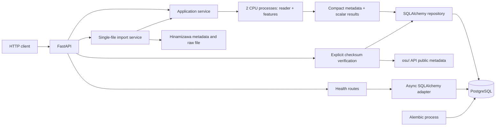

# Архитектура

## Реализовано в M0, M1 и срезе M1a

Модульный монолит с одним Python-пакетом. `main.create_app` — точка сборки;
`config.Settings` валидирует окружение. `api/` содержит транспорт и зависимости,
`infrastructure/database.py` — адаптер PostgreSQL и общую ORM metadata.
`application/` управляет обработкой входа, CPU-процессами и транзакциями;
`analysis/` содержит независимые reader, модели и вычисления;
`infrastructure/analysis_repository.py` сохраняет и читает компактные результаты.

Пул создаётся в FastAPI lifespan без немедленного подключения и закрывается
при завершении. У каждого запроса своя сессия, если endpoint её запрашивает.
Зависимость не делает commit: use case должен явно выбрать границу транзакции.
Liveness не зависит от БД. Readiness выполняет `SELECT 1` с общим таймаутом;
при недоступности возвращает 503 и логирует только класс ошибки.
Readiness не проверяет Alembic head. Compose запускает migration service перед API.

Схема: [foundation.mmd](diagrams/foundation.mmd).

## Обработка входа

В первом срезе M1 добавлены offline `cli.py` и адаптер
`infrastructure/osz.py` для подготовки локальных архивов, без зависимости от БД.
Контракт: [local-import](local-import.md). Следующий срез добавил `analysis/`
с независимыми моделями, reader v14 и raw summary; CLI `inspect-osu` использует
эти функции без БД. Контракт: [osu-parser](osu-parser.md). Медиа не читаются.

REST принимает raw `.osu` до 4 MiB. Application резервирует один из двух слотов
до чтения body. Reader и `basic-raw/1` работают через `ProcessPoolExecutor`;
HTTP ожидает результат. При отмене запроса слот остаётся занят до завершения
процесса. Исходные байты и массивы не пишутся на диск и не возвращаются из
CPU-процесса: наружу выходят только компактные данные для одной транзакции.

В PostgreSQL fingerprint входа, versioned scalar result, кеш metadata osu!
и независимые download source observations.
Повторы защищены unique constraints; два конкурента могут выполнить расчёт,
но сохранить один результат. Подробности: [database](database.md),
[признаки](basic-features.md), [ADR-0003](../adr/0003-transient-inputs-compact-results.md).
Offline extraction остаётся отдельным инструментом подготовки корпуса.

`verify-osu` сопоставляет сохранённый MD5 с внешней metadata через OAuth guest token.
Сеть не требуется при upload/GET/health. API match сохраняется отдельно от file
claims; есть TTL, pacing и bounded HTTP. Контракт: [osu-api](osu-api.md).

`imports/hinamizawa/{id}` использует отдельный источник без OAuth credentials,
скачивает bounded raw file, проверяет hashes/IDs и передаёт bytes существующему
CPU-сценарию. Source observations сохраняются атомарно с result; официальный
match не присваивается по mirror metadata. Контракт: [mirror-import](mirror-import.md).

`domain/` и `workers/` появятся при соответствующих сценариях. Analysis не
импортирует FastAPI или SQLAlchemy. Надёжность фоновых заданий не обеспечивается
`BackgroundTasks`; delivery/retry/staging будут определены на M2.

## Семантика анализа

1. A: измеряемые геометрические, временные, ритмические признаки с определениями.
2. B: skill profile — интерпретация признаков, гипотезы и ограничения.
3. C: multi-label турнирные слоты в контексте турнира, уровня и раунда.

Difficulty и PP — отдельные будущие расчёты. Текущий результат содержит checksum
входа, версии, конфигурацию raw/no-mods и 22 измерения уровня A. Skill profile,
качество классификации и турнирные слоты пока не вычисляются.

Выбор следующих метрик опирается на официальный difficulty/performance code osu!.
Внешний вычислитель подключается через adapter с точной engine/upstream identity;
difficulty и score-dependent performance развиваются отдельными семействами.
Контракт расширения и сохранения истории принят, но runtime этих расчётов пока нет:
[metric-evolution](metric-evolution.md).

## Компромиссы

PostgreSQL обязателен для интеграционных тестов; это сложнее in-memory SQLite,
зато проверяет реальный драйвер, транзакции и миграции. Нет Redis, RabbitMQ и
численных библиотек до сценария, которому они нужны. Нет пользовательской auth
наших endpoints и публичного развёртывания. Внешний OAuth служит только public
metadata lookup; Hinamizawa single-file download работает, durable batch ещё нет.
Локальные порты — loopback.
