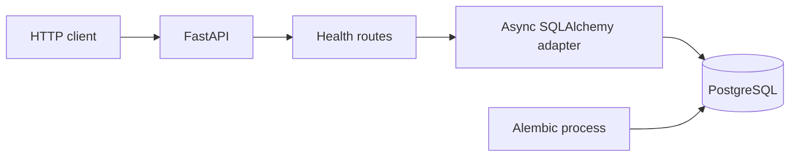

# Архитектура

## Реализовано в M0

Модульный монолит с одним Python-пакетом. `main.create_app` — точка сборки;
`config.Settings` валидирует окружение. `api/` содержит транспорт и зависимости,
`infrastructure/database.py` — адаптер PostgreSQL и общую ORM metadata.
Разделение даёт тестируемые границы без репозиториев и сервисов, у которых пока нет задачи.

Пул создаётся в FastAPI lifespan без немедленного подключения и закрывается
при завершении. У каждого запроса своя сессия, если endpoint её запрашивает.
Зависимость не делает commit: use case должен явно выбрать границу транзакции.
Liveness не зависит от БД. Readiness выполняет `SELECT 1` с общим таймаутом;
при недоступности возвращает 503 и логирует только класс ошибки.
Readiness не проверяет Alembic head. Compose запускает migration service перед API.

Схема: [foundation.mmd](diagrams/foundation.mmd).

## Планируемые границы

В первом срезе M1 добавлены offline `cli.py` и адаптер
`infrastructure/osz.py` для подготовки локальных архивов, без зависимости от БД.
Контракт: [local-import](local-import.md). Parser пока не реализован.

- `domain/`: независимые предметные модели и правила.
- `application/`: импорт, запуск анализа, поиск; координация транзакций.
- `analysis/`: parser и чистые вычисления с версиями и параметрами.
- `infrastructure/`: ORM, локальное файловое хранилище, затем внешние источники.
- `workers/`: отдельные процессы обработки, позже RabbitMQ.

Эти пакеты будут созданы с первым рабочим сценарием. Domain и Analysis не должны
импортировать FastAPI или SQLAlchemy. Длительные CPU-bound вычисления выполняются
вне HTTP event loop. Надёжность фоновых заданий не обеспечивается `BackgroundTasks`;
стратегия delivery/retry/idempotency будет принята на этапе очереди.

## Семантика анализа

1. A: измеряемые геометрические, временные, ритмические признаки с определениями.
2. B: skill profile — интерпретация признаков, гипотезы и ограничения.
3. C: multi-label турнирные слоты в контексте турнира, уровня и раунда.

Difficulty и PP вычисляются и хранятся отдельно. Для каждого результата потребуются
checksum входа, mods и параметры, версия алгоритма и параметры extraction.
Сейчас анализ отсутствует; количественные оценки качества не заявляются.

## Компромиссы

PostgreSQL обязателен для интеграционных тестов; это сложнее in-memory SQLite,
зато проверяет реальный драйвер, транзакции и миграции. Нет Redis, RabbitMQ и
численных библиотек до сценария, которому они нужны. В M0 нет auth, сетевого
импорта и публичного развёртывания. Локальные порты доступны только loopback.
