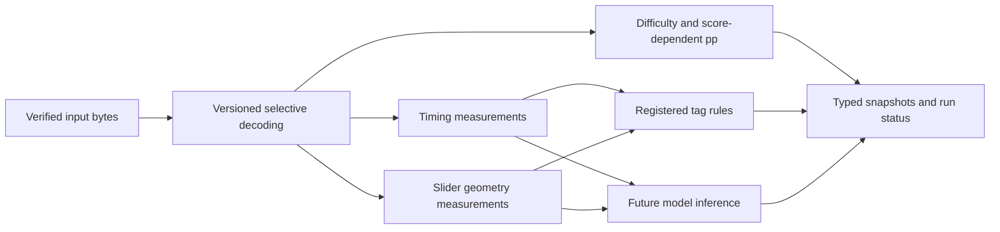

# M3: признаки, определения тегов и бюджет обработки

Status: Accepted tag/feature design; CPU execution foundation implemented, tag runtime/schema pending
Date: 2026-10-26

Владелец расширил M3: official difficulty/pp с компонентами — первый источник,
затем собственные признаки и теги по timing points, опорным точкам/геометрии
слайдеров и будущим ML-методам. Ориентир — около 30 s обработки одной карты;
это мягкий бюджет, не SLA или обязательный timeout. GPU допускается для отдельных
подходящих стадий. Решение: [ADR-0008](../adr/0008-extensible-tags-and-compute-budget.md).

## Разделение понятий

| Слой | Результат | Происхождение |
| --- | --- | --- |
| Measurement | Типизированное число: BPM, counts, geometry summary | Версия определения/экстрактора и input SHA-256 |
| Difficulty | Общий SR и компоненты aim/speed/flashlight/reading при поддержке provider | Engine/upstream, mods/rate/compatibility и schema |
| Performance | Общий pp и компоненты для заданного score/scenario | Difficulty snapshot, score context и версия формул |
| Tag assertion | Назначение версионированного тега карте/сегменту | Rule/model/human method, зависимости и параметры |
| Skill profile / tournament slot | Интерпретация набора признаков/тегов в своём контексте | Отдельный контракт следующих этапов |

Значение измерения не становится тегом само по себе. Например, число red-line BPM
изменений — measurement; правило о достаточной величине/частоте изменений — отдельное
определение тега. ML score не объявляется измеренным свойством карты или вероятностью
без такого контракта и проверки калибровки. Слоты турнира не выводятся автоматически
из названия тега или большого aim pp.

## Конвейер и провайдеры

Application planner строит граф зависимостей выбранного analysis profile. Provider
описывает stable key/version, входные feature schemas, набор выходов, scope,
resource requirement CPU/GPU и поддерживаемые ruleset/mods. Новый rule/model
регистрируется в каталоге, не требует изменения HTTP route или одного общего
классификатора. Один provider может вычислить много признаков/тегов за один вызов;
общие зависимости считаются один раз в пределах обработки.

Profile фиксирует обязательные и необязательные стадии, definition bundle, providers,
параметры и budget policy. Его canonical hash входит в identity задания. До выполнения
проверяются циклы, отсутствующие зависимости и capabilities. Существующий M2 job
пока фиксирует только basic pipeline identity; планировщик и stage jobs появятся
вместе с первым работающим M3 provider, не считаются уже реализованными.

Red timing points задают BPM; inherited green lines/SV рассматриваются отдельно.
Формулы для изменения темпа должны определить работу с одинаковым offset, короткими
участками и границами сегментов. Опорные точки слайдера — input geometry, а не готовая
траектория движения: геометрический provider отдельно версионирует построение кривой,
sampling, traversal/timing, stacking, координаты и mods. Расширение selective reader
делается под эти вычисления; медиа/storyboard/hitsounds для них не требуются.

## Предлагаемая реляционная модель

Это план таблиц, не текущая миграция. ADR-0004 сохраняется: DDL семейства появляется
с первым проверенным adapter и фиксированным набором выходов.

| Таблица/семейство | Назначение |
| --- | --- |
| `difficulty_snapshots` | Typed total/component difficulty и вспомогательные scalar attributes |
| `performance_snapshots` | Typed total/component pp со ссылкой на difficulty и полный score/scenario |
| Отдельные feature-family tables | Собственные timing/geometry/иные scalar measurements, новые поля через миграции |
| `analysis_stage_runs` | Input/profile/provider identity, dependencies, state, timings и resource provenance |
| `tag_definitions` | Stable key, immutable definition revision, method, scope и семантика score/решения |
| `tag_definition_bundles` / members | Версионированный набор определений/выходов, покрываемый provider/profile |
| `analysis_segments` | Версионированная сегментация и диапазоны времени в явно указанной системе координат |
| `tag_assignments` | Run, definition revision, whole-map/segment scope, назначенный тег и допустимый scalar score |

Difficulty предусматривает общий `star_rating`, `aim_difficulty`, `speed_difficulty`,
`flashlight_difficulty`, `reading_difficulty` и выбранные официальные вспомогательные
атрибуты. Performance — total/aim/speed/accuracy/flashlight/reading pp при наличии
поддержки конкретного engine. Отсутствующий атрибут — NULL и известная capability,
не ноль. API snapshot не получает выдуманную engine revision. Итоговые stars/pp
не трактуются как арифметическая сумма компонентов. См. [metric-evolution](metric-evolution.md).

Новый тег добавляет определение/назначения, без столбца на каждое название тега.
Новая числовая величина получает типизированное поле в своём семействе; tag rows
не используются как EAV-хранилище числовых features. JSONB остаётся малой
конфигурацией, не полным output, графом объектов или tensor/vector dump.

Для большого корпуса назначения хранятся разреженно: положительные назначения и
нужные evidence references. Run ссылается на immutable bundle и сообщает полноту
покрытия. Только завершённый exhaustive provider позволяет интерпретировать
отсутствие assignment как «не назначен данным методом/версией». Если определение
не входило в bundle, стадия deferred/unsupported/failed либо контракт не exhaustive,
ответ — unknown, а не отрицательный результат. ML «не назначен» не доказывает
отсутствие паттерна как ground truth. Не создаются пустые строки на каждый возможный
тег каждой карты. Исторические bundle/definitions/runs не переписываются.

Evidence связывает assignment с конкретными snapshot/segment IDs; большие массивы
объектов, feature sequences и attention maps постоянно не сохраняются. Число evidence
rows/сегментов на карту ограничивается контрактом provider. Глубокая диагностика и
исследовательские артефакты требуют отдельного явного режима хранения.

## Версии и повторное использование

Ключ stage включает точный input SHA-256, profile, provider/engine/adapter/schema,
config и identities использованных feature snapshots. Для модели добавляются hash
весов, preprocessing/feature schema, label mapping, threshold/calibration revision
и inference execution profile (например, precision). Dataset/training revision
фиксируется, если известна; неизвестная информация не подменяется предположением.

Модель и её artifact manifest версионируются отдельно от тегов. Model weights не
кладутся в строки результатов; в БД их identity и ссылка на доверенный artifact.
Смена порога или normalization создаёт новую definition/run identity. Аппаратное
ускорение не обещает побитового равенства: численно отличающийся execution profile
различается в identity, пока допустимая эквивалентность не доказана тестами.

Повторный запрос может переиспользовать совместимые scalar snapshots. Если новая
стадия требует objects/anchors, исходник скачивается вновь с SHA pin: скаляры не
заменяют исходные данные. Постоянное хранение карт ради будущего ML не вводится.

## Мягкий бюджет 30 секунд

Начальный профиль проектируется под `target_processing_ms=30000`. Измеряем wall time
от готовых проверенных bytes до commit результата выбранного профиля, включая
preprocessing, CPU/GPU transfer, расчёт, сериализацию и persistence. Ожидание очереди,
получение input и provider cooldown фиксируются отдельно; полное time-to-result
также измеряется. Повторное скачивание между разделёнными стадиями учитывается
в acquisition, не скрывается из общего времени готовности результата.

У обязательных стадий превышение мягкого бюджета отмечается `budget_exceeded`, но
не превращает корректный результат в ошибку и не убивает CPU/GPU на 30-й секунде.
На границе этапов необязательная дорогая стадия может стать deferred_budget и
выполниться отдельным расширенным профилем. Для неё нужен явный статус/зависимость;
базовый результат остаётся доступным. Если обязательная стадия unsupported/failed,
профиль не объявляется полностью рассчитанным. Отсутствующие теги остаются unknown.

Stage states и duration/error records отделены от result identity. Lease/heartbeat,
HTTP timeouts, resource safety limits и мягкий target — разные механизмы. Текущий
lease M2 90 s не заменяется 30 s budget. Конкретные cost estimates и распределение
бюджета по стадиям появятся после профилирования; числа не назначаются как измеренные.

## CPU/GPU execution

Первый difficulty adapter будет выполняться в CPU worker.
Работающая очередь и configurable capacity текущего CPU worker описаны в
[runtime-workers](runtime-workers.md); он пока выполняет basic pipeline.
GPU capability — отдельный
класс исполнителя/маршрутизация для подходящих будущих stages. Базовый сервис
работает без CUDA; обязательная GPU stage без исполнителя ожидает capability или
возвращает unsupported по контракту. CPU fallback разрешается только для заранее
проверенного совместимого execution profile; молчаливая смена модели/precision
недопустима.

GPU worker держит выбранную модель загруженной, использует ограниченную конкуренцию
и при необходимости bounded microbatches с ограничением ожидания. Процесс может
сделать CPU preprocessing и GPU inference одной stage без передачи исходника между
узлами. Отдельная последующая stage при необходимости заново получает тот же input.
В RabbitMQ только ссылки/IDs, не tensors, objects или `.osu`; промежуточные sequences
живут в RAM/VRAM до завершения работы с ними и освобождаются при завершении/ошибке.

GPU выбирается после сравнения полной стоимости, включая transfers и ожидание batch.
При измерении учитывается асинхронность GPU: завершение kernel launch не означает
завершение вычисления; используются корректная синхронизация/events выбранного runtime.
Основание: [CUDA Best Practices](https://docs.nvidia.com/cuda/cuda-c-best-practices-guide/index.html#timing).
Это принцип измерения, не выбор CUDA-библиотеки и не подтверждённое ускорение проекта.

## Проверки перед реализацией и запуском

M3 сначала выбирает точную upstream/port revision и проверяет component coverage
(включая reading), затем реализует provenance, DDL и adapter. Собственные timing/
geometry providers добавляются с математическим определением и synthetic fixtures.
Tag registry должен проверять revisions, dependencies, scope и partial coverage;
смена модели/порогов не перезаписывает старые результаты.

Benchmark оформляется в `docs/experiments/`: версии input/engine/config, hardware,
размеры карт и sample selection; p50/p95/p99, maps/s, RAM/VRAM, холодный/прогретый
worker и времена стадий. Для ML отдельно оценивается качество на размеченных данных,
не только latency. 33 локальные карты — smoke corpus, не доказательство скорости
или качества на библиотеке osu!. 30 s — ориентир до этих замеров, а не достигнутая
характеристика. По согласию владельца ранний UI и logistic baseline M4 уже
реализованы отдельно: [label-workbench](label-workbench.md). Они работают на
basic-raw scalars; rollout автоматических providers и оценка качества ещё впереди.
